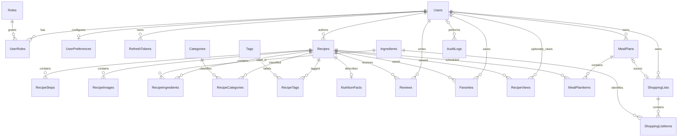

# Database baseline — Phase 1

Trạng thái: thiết kế tổng thể. Đã có EF model và migration đầu tiên cho Identity/RefreshTokens và Recipes/Steps/Images/Ingredients/Categories cùng bảng join; Khánh đã cung cấp ảnh xác nhận áp dụng trên Neon recipehub_dev. Auth integration tests cũng đã chạy trên schema tạm riêng. UserPreferences, Tags, NutritionFacts, tương tác, thực đơn, mua sắm và AuditLogs chưa triển khai trong EF model.

## Quy ước

- Business IDs dùng UUID; thời gian dùng `timestamptz` UTC, ngày thực đơn dùng `date`.
- Số lượng dùng `numeric(12,3)`; không dùng floating point cho phép cộng lượng mua sắm.
- Identity dùng `IdentityUser<Guid>` và `IdentityRole<Guid>`; ERD ghi Users/Roles cho dễ đọc. Bảng vật lý dự kiến AspNetUsers/AspNetRoles và các bảng join/claims/logins/tokens chuẩn Identity.
- Mọi cột FK bắt buộc là NOT NULL trừ khi ghi tùy chọn. Tên vật lý theo EF conventions; khóa ghép phải cấu hình rõ trong Fluent API.
- Text mô tả và instructions là plain text, không nhận HTML tùy ý.

## ERD và cardinality

## Data dictionary và constraints

### Identity và sở thích

- **Users:** chuẩn ASP.NET Identity, bổ sung DisplayName varchar(100), CreatedAt, UpdatedAt. NormalizedEmail unique và bắt buộc trong ứng dụng; không công khai Email qua recipe author DTO. Không lưu password thô.
- **Roles/UserRoles:** chuẩn Identity; roles User/Admin. UserRoles PK(UserId,RoleId).
- **UserPreferences:** UserId PK/FK, DietaryPreferences jsonb array, Allergens jsonb array, PreferredMaxCookingMinutes int nullable >0, UpdatedAt. Các trường là tùy chọn; không coi thuật toán gợi ý là bảo đảm y tế về dị ứng.
- **RefreshTokens:** Id, UserId, FamilyId UUID (cùng giá trị trong một chuỗi rotation), TokenHash varchar(64) unique, CreatedAt, ExpiresAt, RevokedAt nullable, ReplacedByTokenId nullable self FK. Lưu SHA-256 của token ngẫu nhiên đủ mạnh, không lưu raw token. ExpiresAt > CreatedAt; self FK dùng Restrict, purge chuỗi token phải xử lý tham chiếu. Bảng bổ sung cần cho rotation/revoke. Dùng transaction/conditional update để mỗi token chỉ rotate một lần; reuse thu hồi mọi token còn hiệu lực cùng FamilyId.

### Công thức và danh mục

- **Recipes:** Id, AuthorId, Title varchar(200), Slug varchar(240) unique, Description text (API giới hạn 5000), Servings int >0, PrepMinutes/CookMinutes int >=0, Difficulty varchar(10) thuộc Easy/Medium/Hard, Status varchar(12) thuộc Draft/Published/Archived, CreatedAt/UpdatedAt, PublishedAt nullable, SearchVector tsvector. Published yêu cầu PublishedAt có giá trị.
- **RecipeSteps:** Id, RecipeId, Position int >0, Instruction text (API giới hạn 5000), DurationMinutes int nullable >=0. Unique(RecipeId,Position).
- **RecipeImages:** Id, RecipeId, Url varchar(2048), AltText varchar(200), Position int >=0. Unique(RecipeId,Position); vị trí 0 là ảnh đại diện, tránh nhiều cờ IsPrimary bị lệch.
- **Ingredients:** Id, Name varchar(150), NormalizedName varchar(150) unique, DefaultUnit varchar(20). NormalizedName trim/lower invariant ở application.
- **RecipeIngredients:** Id, RecipeId, IngredientId, Quantity numeric(12,3) >0, Unit varchar(20), Note varchar(300) nullable, Position int >0. Unique(RecipeId,Position); cho phép cùng nguyên liệu ở bước/phần khác nhau.
- **Categories:** Id, Name varchar(100), Slug varchar(120) unique.
- **RecipeCategories:** PK(RecipeId,CategoryId).
- **Tags:** Id, Name varchar(100), Slug varchar(120) unique.
- **RecipeTags:** PK(RecipeId,TagId).
- **NutritionFacts:** RecipeId PK/FK, Calories/ProteinGrams/CarbsGrams/FatGrams numeric nullable >=0, Source varchar(200). Giá trị tính trên một khẩu phần; không tự bịa dinh dưỡng từ seed.

### Tương tác

- **Reviews:** Id, RecipeId, UserId, Rating smallint 1..5, Comment varchar(2000), ModerationStatus varchar(10) thuộc Pending/Visible/Hidden, CreatedAt/UpdatedAt. Unique(UserId,RecipeId).
- **Favorites:** PK(UserId,RecipeId), CreatedAt.
- **RecipeViews:** Id, RecipeId, UserId nullable, ViewedAt. Không lưu IP đầy đủ mặc định; có retention và chống ghi view trùng trong cùng cửa sổ thời gian ở application.

### Thực đơn và mua sắm

- **MealPlans:** Id, UserId, WeekStart date (thứ Hai), CreatedAt/UpdatedAt. Unique(UserId,WeekStart); CHECK extract(isodow from WeekStart)=1.
- **MealPlanItems:** Id, MealPlanId, RecipeId, PlannedDate date, MealType varchar(10) thuộc Breakfast/Lunch/Dinner/Snack, Servings int >0. Unique(MealPlanId,PlannedDate,MealType,RecipeId). Ngày phải nằm trong tuần của MealPlan: validate trong cùng use case/transaction vì CHECK không tham chiếu bảng khác.
- **ShoppingLists:** Id, UserId, MealPlanId nullable, Name varchar(150), CreatedAt/UpdatedAt. Partial unique(MealPlanId) WHERE MealPlanId IS NOT NULL để mỗi thực đơn có tối đa một danh sách được sinh; danh sách thủ công không có MealPlanId. MealPlan.UserId phải khớp ShoppingList.UserId: enforce bằng alternate key MealPlans(Id,UserId) và composite FK ShoppingLists(MealPlanId,UserId).
- **ShoppingListItems:** Id, ShoppingListId, IngredientId, Quantity numeric(12,3) >0, Unit varchar(20), IsPurchased bool, IsManuallyEdited bool, Note varchar(300) nullable. Unique(ShoppingListId,IngredientId,Unit). Normalize unit bằng mã whitelist; chưa tự quy đổi g sang ml hoặc đơn vị tự do.
- **AuditLogs:** Id, ActorUserId nullable, Action varchar(100), EntityType varchar(100), EntityId varchar(100), OccurredAt, Metadata jsonb. Không lưu tokens/passwords hoặc bản chụp chứa secrets; có retention.

## Delete behavior

- User → Recipes, Reviews, MealPlans, ShoppingLists: Restrict. Giai đoạn đầu khóa tài khoản thay vì hard delete; thiết kế anonymization/xóa dữ liệu riêng trước khi cho phép xóa user.
- User → UserPreferences/RefreshTokens/UserRoles/Favorites: Cascade; User → RecipeViews/AuditLogs: SetNull.
- Recipe → Steps/Images/RecipeIngredients/RecipeCategories/RecipeTags/NutritionFacts/Reviews/Favorites/RecipeViews: Cascade nếu hard delete.
- Recipe → MealPlanItems: Restrict. DELETE recipe thường chuyển Archived, giữ thực đơn và lịch sử; không dùng hard delete trong API người dùng.
- Ingredient → RecipeIngredients/ShoppingListItems: Restrict; Category/Tag → các bảng join: Restrict để yêu cầu gỡ liên kết có chủ đích.
- MealPlan → MealPlanItems: Cascade; MealPlan → ShoppingLists: Restrict, phải gỡ nguồn hoặc xử lý danh sách trước khi xóa thực đơn.
- ShoppingList → ShoppingListItems: Cascade. Self FK RefreshTokens: Restrict.

## Indexes và tìm kiếm

- Unique indexes theo constraints ở trên; index mọi FK cần join, kiểm tra tránh trùng index tiền tố do EF tạo.
- Recipes(Status,CreatedAt DESC,Id), Recipes(AuthorId,UpdatedAt DESC,Id), Recipes(Status,PublishedAt DESC,Id).
- RecipeIngredients(IngredientId,RecipeId); RecipeCategories(CategoryId,RecipeId); RecipeTags(TagId,RecipeId).
- Reviews(RecipeId,ModerationStatus,CreatedAt DESC,Id); Favorites(RecipeId); RecipeViews(RecipeId,ViewedAt), RecipeViews(UserId,ViewedAt).
- MealPlans(UserId,WeekStart) đã có unique; MealPlanItems(MealPlanId,PlannedDate).
- RefreshTokens(UserId,ExpiresAt), RefreshTokens(FamilyId); AuditLogs(OccurredAt), AuditLogs(ActorUserId,OccurredAt).
- GIN Recipes.SearchVector: title trọng số A, description B, cấu hình PostgreSQL `simple` là baseline đa ngôn ngữ, chưa hứa tìm kiếm tiếng Việt không dấu. Full-text không đồng nghĩa substring; thêm trigram/unaccent chỉ sau benchmark và kiểm tra extension Neon.
- SearchVector generated stored từ cùng hàng Recipes; tìm theo ingredient bằng join, không đưa aggregate qua bảng khác vào generated column.
- Phân trang page/pageSize với giới hạn 100, order có Id làm tie-breaker. Khi dữ liệu lớn và offset chậm mới chuyển keyset với API version phù hợp.

## Migrations, seed và dung lượng

Chưa thực thi DDL. EF configuration phải hiện thực toàn bộ unique/check/delete rules trước khi tạo migration đầu tiên. Review SQL, dùng DB test riêng trước khi áp dụng Neon development.

Seed theo external source ID hoặc khóa định danh seed ổn định, batch và idempotent. Dataset/giấy phép chưa chọn; giả lập phải được đánh dấu. Không ép đạt 200 MB bằng dữ liệu rác. Mục tiêu 180–220 MB đo cả index, dừng trước hạn mức Neon thực tế, kiểm tra lại hạn mức tại thời điểm seed.

Script đọc dung lượng nằm tại `../scripts/check-size.sql`; không cần chạy khi chưa có kết nối.
