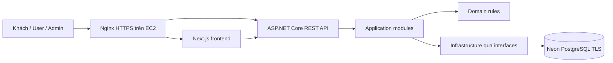
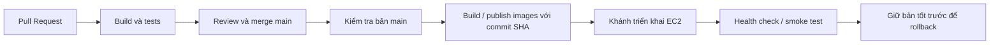

# RecipeHub — Kiến trúc

## Quyết định nền tảng

Một backend triển khai chung, chia module nghiệp vụ trong từng tầng. Không tạo một service/database riêng cho mỗi module. Giữ cấu trúc solution hiện có:

```text
backend/
  RecipeHub.Api/              HTTP, middleware, DI composition
  RecipeHub.Application/      Use cases, DTOs, validation, interfaces
  RecipeHub.Domain/           Entities và quy tắc nghiệp vụ
  RecipeHub.Infrastructure/   EF Core, Identity, Neon, integrations
  RecipeHub.Tests/            xUnit và kiểm thử tích hợp
```

Application tham chiếu Domain; Infrastructure tham chiếu Application; Api tham chiếu Application/Infrastructure để lắp ghép. Domain không tham chiếu ASP.NET/EF. Không đưa EF entities ra API. Tests integration đặt cùng project lúc đầu, phân thư mục Unit/Integration khi số tests tăng.

Các module dự kiến: Identity, Recipes, Ingredients, Categories, Search, Favorites, Reviews, MealPlanning, ShoppingLists, Recommendations, Analytics, Administration.

## Sơ đồ hệ thống



Database không chạy container trên EC2 theo phạm vi đã chọn. Development có thể gọi API trực tiếp qua localhost; deployment ưu tiên cùng origin, Nginx chuyển `/api` sang backend, tránh cấu hình auth cross-site không cần thiết.

## Công nghệ

- Backend hiện target net10.0; SDK máy đã kiểm tra 10.0.402, .NET 10 là LTS. `global.json` cho phép SDK feature band .NET 10 mới hơn.
- Visual Studio 2026, workload ASP.NET and web development.
- API đã dùng Microsoft.AspNetCore.OpenApi 10.0.13; chỉ expose JSON OpenAPI trong Development.
- Persistence có EF Core/Identity EF10.0.13 và Npgsql provider10.0.3; restore/build xác nhận tương thích. Khánh đã áp dụng InitialIdentityAndRecipes trên Neon recipehub_dev; auth tests dùng schema tạm độc lập.
- Frontend theo Next.js App Router, TypeScript, Tailwind/shadcn, RHF/Zod, TanStack Query. Khang kiểm tra phiên bản và sở hữu lockfile.
- Serilog, JWT, rate limiting và Swagger UI chưa được triển khai; không nhầm OpenAPI JSON hiện có với Swagger UI.

Nguồn xác nhận .NET/Visual Studio: https://learn.microsoft.com/en-us/dotnet/core/install/windows ; https://dotnet.microsoft.com/en-us/download/visual-studio-sdks

## Giao dịch và bảo mật

- Identity quản lý password hash, roles và chính sách khóa tài khoản; nghiệp vụ chỉ lưu UserId.
- Mọi truy vấn dữ liệu riêng phải scope theo authenticated UserId; không tin UserId từ request body.
- Tạo/cập nhật recipe cùng steps, ingredients, categories và tags trong một transaction.
- Sinh shopping list theo snapshot thực đơn và khẩu phần; không thay đổi danh sách đã mua chỉ vì recipe gốc đổi.
- JWT middleware và auth endpoints đã hoạt động; cookie/CSRF/rotation ghi trong API contract và AUTH_GUIDE. Chưa có admin bootstrap hoặc JWT denylist toàn cục.
- Không tự chạy `Database.Migrate`/seed khi startup; triển khai migration là bước có review riêng.

## CI/CD và phân công



Linh sở hữu Jenkinsfile và test reports; Khánh sở hữu cấu hình AWS, Nginx và deployment scripts; Khang sở hữu cấu hình frontend. Chưa có Dockerfiles, Jenkinsfile hay deployment scripts được triển khai. Không giả định Jenkins trong Docker đã có Docker CLI/daemon, .NET SDK hoặc Playwright browsers.

## Khả năng vận hành

Build images tại CI thay vì EC2 1 GiB. Trước deploy đo RAM, CPU, disk và tải cơ bản; không tự nâng gói. Health `/health/live` chỉ kiểm tra tiến trình, `/health/ready` kiểm tra kết nối database và trả503 nếu chưa cấu hình; chưa kiểm tra schema/migration. Readiness trên Neon thật, log aggregation, backups và rollback phải xác minh ở phase vận hành. Rollback image không tự hoàn tác database migration; dùng schema tương thích ngược và backup có thử restore.
