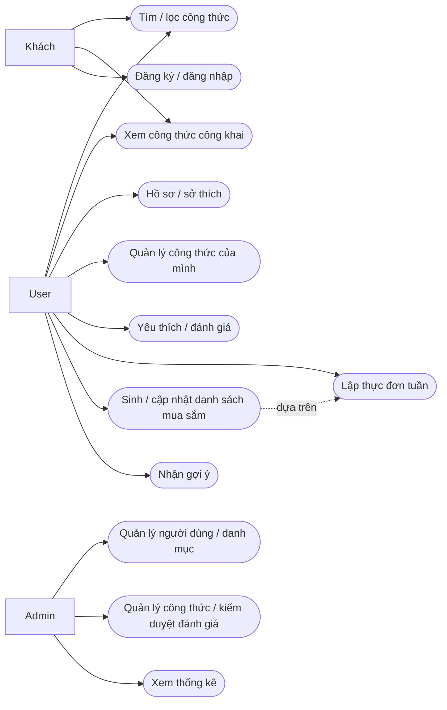
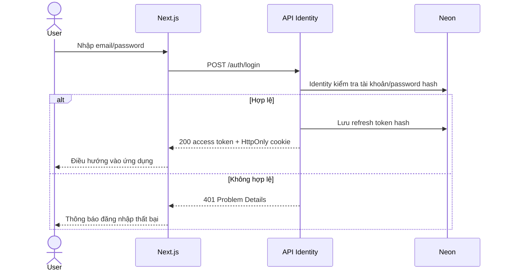
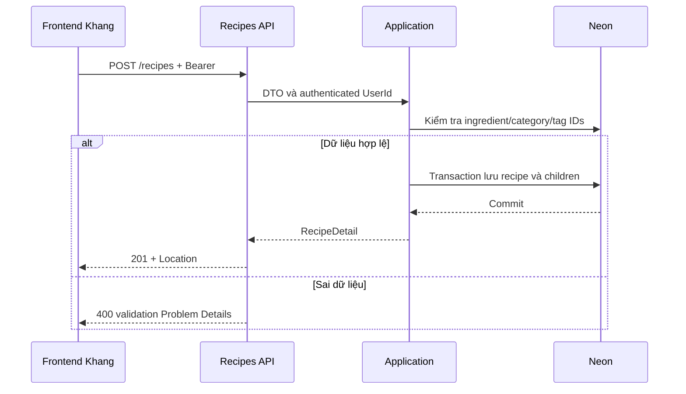
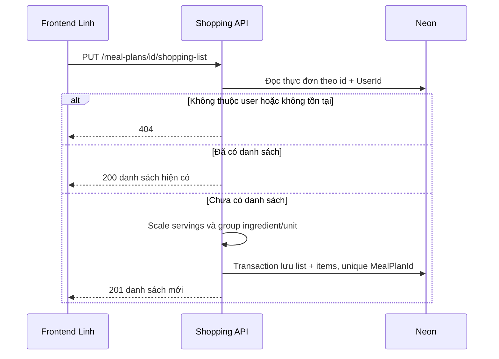

# Use cases và sequence baseline

Mermaid flowchart biểu diễn các actor/use case; các sơ đồ mô tả thiết kế, không khẳng định chức năng đã chạy.

## UC-01 — Đăng nhập

Điều kiện: có tài khoản hoạt động. Thành công: nhận access token ngắn hạn và refresh cookie; không lưu raw refresh token trong DB. Thất bại: thông báo chung, rate limiting và không ghi secrets vào logs.

## UC-02 — Tạo công thức

Điều kiện: User đăng nhập. Server lấy AuthorId từ token, validate toàn bộ dữ liệu và quyền; transaction bảo đảm không có recipe thiếu children khi lỗi.

## UC-03 — Sinh danh sách mua sắm

Điều kiện: thực đơn thuộc user; mỗi recipe có servings và lượng hợp lệ. Chỉ cộng cùng ingredient/unit; không cộng g với ml. Gọi lại trả danh sách đã có.

Concurrent generation phải dựa unique constraint và xử lý xung đột để đọc lại list đã tạo; không chỉ kiểm tra bằng một SELECT rồi INSERT thiếu bảo vệ.
